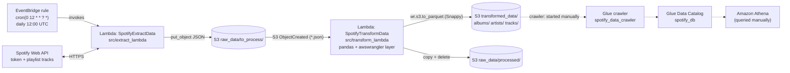

# Serverless Spotify Data Pipeline

A small serverless ETL pipeline on AWS. Once a day, a Lambda function fetches the tracks of one Spotify playlist (Top 50 Global by default) through the Spotify Web API and saves the raw JSON to S3. The upload triggers a second Lambda, which uses pandas and AWS Data Wrangler (AWS SDK for pandas) to split the data into album, artist and track tables stored as Parquet. A Glue crawler can then catalog those tables for querying in Amazon Athena. All AWS resources are created by Python/Boto3 scripts.

## Architecture



Solid arrows are automated by the deployed code. Dashed arrows are manual steps: the code creates the crawler but never starts it, and it creates no Athena resources.

| Component | What the code does | File |
|---|---|---|
| EventBridge | Creates rule `SpotifyDailyExtractionRule` (daily at 12:00 UTC) targeting the extract Lambda | `infra/setup_eventbridge.py` |
| Extract Lambda | Gets a Spotify client-credentials token, fetches the first page of one playlist's tracks (`SPOTIFY_PLAYLIST_ID`, default `37i9dQZEVXbMDoHDwVN2tF`), writes the JSON unchanged to `raw_data/to_process/` | `src/extract_lambda/lambda_function.py` |
| S3 trigger | `s3:ObjectCreated:*` on `raw_data/to_process/*.json` invokes the transform Lambda | `infra/setup_lambda.py` |
| Transform Lambda | Builds de-duplicated album, artist and track DataFrames, writes each with `wr.s3.to_parquet` to `transformed_data/<table>/`, moves the raw file to `raw_data/processed/` | `src/transform_lambda/lambda_function.py` |
| Glue | Creates database `spotify_db`, role `SpotifyGlueCrawlerRole` and crawler `spotify_data_crawler` on `transformed_data/`. The crawler is **not started** by the code. | `infra/setup_glue_athena.py` |
| Athena | No resources created. Query manually after running the crawler. | — |
| IAM | Roles `SpotifyExtractLambdaRole` and `SpotifyTransformLambdaRole` (`AWSLambdaBasicExecutionRole` + `AmazonS3FullAccess`); the Glue role (`AWSGlueServiceRole` + `AmazonS3FullAccess`) | `infra/setup_iam_roles.py`, `infra/setup_glue_athena.py` |

## Project structure

```text
├── deploy_all.py               # Runs all infra scripts in order (reads a local credentials.json)
├── infra/                      # Boto3 scripts that create the AWS resources
│   ├── setup_s3.py             # Bucket + raw_data/ and transformed_data/ prefixes
│   ├── setup_iam_roles.py      # Lambda execution roles
│   ├── setup_lambda.py         # Zips and deploys both Lambdas, adds the S3 trigger
│   ├── setup_eventbridge.py    # Daily schedule for the extract Lambda
│   └── setup_glue_athena.py    # Glue database, crawler role and crawler
├── src/
│   ├── extract_lambda/         # Spotify API → S3 raw JSON
│   └── transform_lambda/       # Raw JSON → Parquet (pandas + awswrangler)
├── benchmarks/                 # Local-only measurement scripts (no AWS, no Spotify calls)
└── results/                    # Measured results, resume-claims check, raw logs
```

## Setup and deployment

### Prerequisites
- Python 3.10+ with `boto3`
- An AWS identity with the permissions listed below
- A Spotify Developer app (client ID and secret). **Note:** since 27 Nov 2024, Spotify no longer serves Spotify-owned editorial playlists (which include Top 50 Global) to new apps or to development-mode apps without an approved extension ([Spotify announcement](https://developer.spotify.com/blog/2024-11-27-changes-to-the-web-api)). You may need to set `SPOTIFY_PLAYLIST_ID` on the extract Lambda to a playlist your app can read.

### Option A: step by step (recommended; uses your normal AWS profile or SSO)
```bash
python infra/setup_s3.py --bucket-name YOUR_BUCKET_NAME
python infra/setup_iam_roles.py
python infra/setup_lambda.py --bucket-name YOUR_BUCKET_NAME --client-id ID --client-secret SECRET
python infra/setup_eventbridge.py            # optional: --schedule "cron(...)"
python infra/setup_glue_athena.py --bucket-name YOUR_BUCKET_NAME
```
Set `AWS_DEFAULT_REGION` (or a profile region) first. `setup_s3.py` falls back to `us-east-1` and `setup_lambda.py` to `ap-south-1` if no region is set.

### Option B: `deploy_all.py`
Create a `credentials.json` (git-ignored) with the keys `AWS_ACCESS_KEY_ID`, `AWS_SECRET_ACCESS_KEY`, `AWS_REGION`, `SPOTIFY_CLIENT_ID` and `SPOTIFY_CLIENT_SECRET`, then run `python deploy_all.py`. The script picks a **random bucket name on every run** and deletes `credentials.json` when it finishes. Because it needs long-lived access keys, Option A is the safer choice.

### After deployment (manual)
1. Wait for the first scheduled run, or invoke `SpotifyExtractData` once yourself.
2. Start `spotify_data_crawler` in the Glue console.
3. In Athena, set a query-result location and query `spotify_db`.

There is no teardown script. Delete the resources by hand: EventBridge rule, both Lambdas, the S3 bucket, the Glue crawler and database, and the three IAM roles.

### IAM permissions

**Needed by whoever runs the deploy scripts.** This list comes from the Boto3 calls in `infra/`. It has not been tested against a live account.

| Service | Actions |
|---|---|
| S3 | `s3:CreateBucket`, `s3:PutObject`, `s3:PutBucketNotification` |
| IAM | `iam:CreateRole`, `iam:GetRole`, `iam:AttachRolePolicy`, `iam:PassRole` |
| Lambda | `lambda:CreateFunction`, `lambda:GetFunction`, `lambda:UpdateFunctionCode`, `lambda:UpdateFunctionConfiguration`, `lambda:AddPermission`, `lambda:GetLayerVersion` |
| EventBridge | `events:PutRule`, `events:PutTargets` |
| Glue | `glue:CreateDatabase`, `glue:CreateCrawler`, `glue:UpdateCrawler` |

**Attached to the runtime roles by the scripts:** see the IAM row in the component table above. `AmazonS3FullAccess` is broader than needed. A tighter policy would allow only `s3:GetObject`, `s3:PutObject` and `s3:DeleteObject` on this bucket's prefixes.

## Cost note

No cost has been measured; there are no billing records for this project. The billable parts are Lambda invocations (two per day plus any manual runs), S3 storage and requests, Glue crawler runs (billed per run when started), and Athena (billed by data scanned per query). Check current AWS pricing for your region rather than relying on an estimate here.

## Results

> **These are local measurements, not AWS measurements.** They were taken on 2026-11-26 on a laptop (i5-12500H, Windows 11), with S3 mocked by moto and a **synthetic 50-track sample** (`benchmarks/sample_data/synthetic_playlist_50.json`) instead of real Spotify data. They don't show how the pipeline performs on AWS Lambda or how big real data is. Full details, commands and raw logs are in [results/results.md](results/results.md).

| Metric | Value | Measured where |
|---|---|---|
| Unit tests | None exist | Repository check |
| Static checks | 9/9 files compile; pyflakes: 5 warnings, 0 errors | Local |
| Raw JSON → Parquet size | 28102 B → 20043 B over 3 tables (albums 40, artists 35, tracks 50 rows) | Local, synthetic 50-track sample, S3 mocked |
| Transform handler execution time | median 341.7 ms (min 290.9, max 418.3, n=5) | Local, synthetic 50-track sample, S3 mocked; **not** AWS Lambda duration |
| Extract handler execution time | median 26.6 ms (min 22.2, max 28.3, n=5) | Local, Spotify calls stubbed, S3 mocked; **not** AWS Lambda duration |

**NOT MEASURED** (no saved evidence): Lambda duration and memory on AWS, Athena runtime and data scanned, real S3 object sizes, records per real run, number of completed scheduled runs, Glue crawler results, cost.

A check of the resume claims against this code is in [results/resume_claims_check.md](results/resume_claims_check.md).

## Known limitations

- **Mixed date formats lose data.** Spotify gives some album release dates as `YYYY` and others as `YYYY-MM-DD`. `pd.to_datetime(..., errors='coerce')` (`src/transform_lambda/lambda_function.py:86`) infers one format and turns the other into null. In the local synthetic test, 36 of 40 album dates became null. Reproduced on **pandas 3.1.1**; the pandas version in the Lambda layer wasn't tested.
- **The Glue crawler is not started by the code.** `infra/setup_glue_athena.py` creates it with no schedule; it has to be run by hand.
- **No Athena setup.** No workgroup, query-result location or saved queries are created. Athena is only used manually.
- **No teardown script.** Resources have to be deleted by hand, and `deploy_all.py` creates a new randomly named bucket on every run.
- **Broad S3 permissions.** All IAM roles get the AWS-managed `AmazonS3FullAccess` policy instead of access scoped to this bucket.
- **Spotify API access.** Since 27 Nov 2024, new Spotify apps (and development-mode apps without an approved extension) may not be able to read Spotify-owned editorial playlists such as the default Top 50 Global ([announcement](https://developer.spotify.com/blog/2024-11-27-changes-to-the-web-api)).

## Analytics example

After running the crawler, assuming it creates tables named after the `transformed_data/` subfolders (not verified here):

```sql
-- Top 10 most popular tracks
SELECT t.track_name, ar.artist_name, al.album_name, t.track_popularity
FROM "spotify_db"."tracks" t
JOIN "spotify_db"."artists" ar ON t.artist_id = ar.artist_id
JOIN "spotify_db"."albums"  al ON t.album_id  = al.album_id
ORDER BY t.track_popularity DESC
LIMIT 10;
```

Each run writes new Parquet files, so tracks that stay in the playlist appear once per day. Add `DISTINCT` or filter by file date as needed.

## 📝 Copyright & License
Copyright (c) 2026 Lokesh Reddy. All Rights Reserved.

This repository is provided strictly for viewing and portfolio display purposes only. You are not granted permission to download, use, copy, modify, distribute, or create derivative works from this code.
