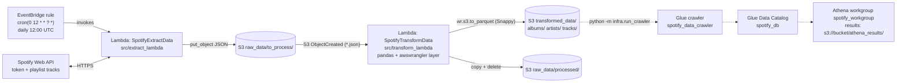

# Serverless Spotify Data Pipeline

A small serverless ETL pipeline on AWS. Once a day, a Lambda function fetches the tracks of one Spotify playlist (Top 50 Global by default) through the Spotify Web API and saves the raw JSON to S3. The upload triggers a second Lambda, which uses pandas and AWS Data Wrangler (AWS SDK for pandas) to split the data into album, artist and track tables stored as Parquet. A Glue crawler catalogs those tables so they can be queried in an Amazon Athena workgroup. Every AWS resource is created, and removed again, by Python/Boto3 scripts.

> **Testing status.** All automated tests run against [moto](https://github.com/getmoto/moto), an in-memory mock of AWS, never against real AWS. Nothing in this repository has been run against a real AWS account since the original deployment, and none of the changes on the `fix/pipeline-hardening` branch have been. See [What is and isn't verified](#what-is-and-isnt-verified).

## Architecture



Solid arrows run automatically once deployed. Dashed arrows are started by you: the crawler is started with one command (it has no schedule), and Athena queries are run by hand in the workgroup.

| Component | What the code does | File |
|---|---|---|
| EventBridge | Rule `SpotifyDailyExtractionRule` (daily at 12:00 UTC) targeting the extract Lambda | `infra/setup_eventbridge.py` |
| Extract Lambda | Gets a Spotify client-credentials token, fetches the first page of one playlist's tracks (`SPOTIFY_PLAYLIST_ID`, default `37i9dQZEVXbMDoHDwVN2tF`), writes the JSON unchanged to `raw_data/to_process/`. Errors are logged and re-raised. | `src/extract_lambda/lambda_function.py` |
| S3 trigger | `s3:ObjectCreated:*` on `raw_data/to_process/*.json` invokes the transform Lambda | `infra/setup_lambda.py` |
| Transform Lambda | Builds de-duplicated album, artist and track tables, writes each with `wr.s3.to_parquet` to `transformed_data/<table>/`, then moves the raw file to `raw_data/processed/`. On any error it logs, re-raises and leaves the raw file in place. | `src/transform_lambda/lambda_function.py` |
| Glue | Database `spotify_db` and crawler `spotify_data_crawler` on `transformed_data/` | `infra/setup_glue_athena.py`, `infra/run_crawler.py` |
| Athena | Workgroup `spotify_workgroup`: results in `s3://<bucket>/athena_results/`, settings enforced, queries scanning more than 1 GiB are cancelled | `infra/setup_glue_athena.py` |
| IAM | Three roles, each with an inline S3 policy scoped to the pipeline bucket (see [IAM permissions](#iam-permissions)) | `infra/setup_iam_roles.py` |

### Albums table: release dates

Spotify gives `album.release_date` as `YYYY`, `YYYY-MM` or `YYYY-MM-DD`. The albums table keeps the raw string in `album_release_date` and adds `album_release_date_precision` (`year`, `month` or `day`) and `album_release_date_parsed` (a timestamp for the first day of that period, or null if the value isn't a real date, such as Spotify's `0000`). This changed the albums schema: `album_release_date` used to be a timestamp.

## Project structure

```text
├── deploy_all.py               # Deploys everything (fixed bucket name, standard AWS credential chain)
├── infra/                      # Boto3 scripts, run as modules: python -m infra.<name>
│   ├── config.py               # Shared names, bucket-name and region checks
│   ├── setup_s3.py             # Bucket (public access blocked)
│   ├── setup_iam_roles.py      # Three roles with bucket-scoped inline policies
│   ├── setup_lambda.py         # Packages and deploys both Lambdas, adds the S3 trigger
│   ├── setup_eventbridge.py    # Daily schedule for the extract Lambda
│   ├── setup_glue_athena.py    # Glue database + crawler, Athena workgroup
│   ├── run_crawler.py          # One command to start (and wait for) the crawler
│   ├── spotify_credentials.py  # Reads Spotify credentials from env vars or a hidden prompt
│   └── teardown.py             # Deletes everything deploy_all.py creates
├── src/
│   ├── extract_lambda/         # Spotify API → S3 raw JSON
│   └── transform_lambda/       # Raw JSON → Parquet (pandas + awswrangler)
├── tests/                      # pytest + moto (no AWS, no Spotify calls)
├── benchmarks/                 # Local-only measurement scripts
├── results/                    # Measured results, resume-claims check, raw logs
├── requirements-dev.txt        # Test and lint dependencies (Python 3.11)
├── requirements-lambda310.txt  # Python 3.10 pins matching the Lambda layer (see CI matrix)
└── .github/workflows/tests.yml # CI: flake8 + pytest on every push and pull request
```

## Setup and deployment

### Prerequisites
- Python 3 with `boto3` to run the deploy scripts. The test suite has been run on Python 3.11.9 and 3.10.22; the Lambda functions use the `python3.10` runtime (see [Known limitations](#known-limitations) for its support status).
- AWS credentials from the standard chain: an AWS CLI profile (`AWS_PROFILE`), SSO, or `AWS_ACCESS_KEY_ID`/`AWS_SECRET_ACCESS_KEY` in the environment. **No credentials file is read from this repository.**
- An AWS region set (`AWS_REGION`/`AWS_DEFAULT_REGION` or in the profile). The scripts stop with an error if none is set.
- A Spotify Developer app (client ID and secret). **Note:** since 27 Nov 2024, Spotify no longer serves Spotify-owned editorial playlists (which include Top 50 Global) to new apps or to development-mode apps without an approved extension ([Spotify announcement](https://developer.spotify.com/blog/2024-11-27-changes-to-the-web-api)). You may need to set `SPOTIFY_PLAYLIST_ID` on the extract Lambda to a playlist your app can read.

### Deploy
```bash
pip install boto3
export AWS_PROFILE=my-profile AWS_REGION=eu-west-1        # or any other way of configuring credentials
export SPOTIFY_PIPELINE_BUCKET=my-unique-bucket-name      # or pass --bucket-name
export SPOTIFY_CLIENT_ID=...                              # if unset, you are prompted;
# SPOTIFY_CLIENT_SECRET: if unset, you are prompted with hidden input (recommended over exporting it)
python deploy_all.py
```
- The bucket name is **fixed**: rerunning `deploy_all.py` with the same name updates the existing resources instead of creating new ones. If the name is taken by another AWS account, the script stops with a clear error.
- The Spotify secret is never accepted as a command-line argument and is never printed.
- Options: `--schedule "cron(...)"`, `--pandas-layer-arn ARN` (if the default `AWSSDKPandas-Python310:14` layer isn't published in your region), `--run-crawler`.

Individual steps can also be run on their own, e.g. `python -m infra.setup_s3 --bucket-name NAME` or `python -m infra.setup_lambda --bucket-name NAME`.

### After deployment
1. Wait for the first scheduled run, or invoke `SpotifyExtractData` once yourself.
2. Catalog the Parquet files: `python -m infra.run_crawler --wait`. It prints the crawl status and the tables it created.
3. In Athena, choose workgroup `spotify_workgroup` and database `spotify_db`.

### Tear down
```bash
python -m infra.teardown --bucket-name NAME          # dry run: lists what would be deleted
python -m infra.teardown --bucket-name NAME --yes    # deletes
```
This deletes the EventBridge rule, both Lambda functions and their CloudWatch log groups, the Glue crawler and database (with its tables), the Athena workgroup, every object in the bucket and the bucket itself, and the three IAM roles. It refuses to delete a bucket owned by another account, and is safe to rerun.

### Secrets: current approach and the better option
The deploy reads the Spotify client secret from `SPOTIFY_CLIENT_SECRET` or a hidden prompt and stores it as an environment variable of the extract Lambda. That keeps it out of the repository, shell history and process listings, but anyone with `lambda:GetFunctionConfiguration` on the function can read it.

**Better (not implemented):** store the secret in **AWS Secrets Manager**, put only the secret's ARN in the Lambda's environment, grant the extract role `secretsmanager:GetSecretValue` on that one secret, and have the Lambda fetch (and cache) it at runtime. Rotation then doesn't need a redeploy.

### IAM permissions

**Runtime roles** (created by `infra/setup_iam_roles.py`; the docstring explains each permission):

| Role | Permissions | Why |
|---|---|---|
| `SpotifyExtractLambdaRole` | `AWSLambdaBasicExecutionRole` | CloudWatch Logs |
| | `s3:PutObject` on `<bucket>/raw_data/to_process/*` | Write the raw JSON |
| `SpotifyTransformLambdaRole` | `AWSLambdaBasicExecutionRole` | CloudWatch Logs |
| | `s3:GetObject`, `s3:DeleteObject` on `<bucket>/raw_data/to_process/*` | Read the raw JSON (also the copy source), remove it after copying |
| | `s3:PutObject` on `<bucket>/raw_data/processed/*` and `<bucket>/transformed_data/*` | Copy destination; Parquet output |
| `SpotifyGlueCrawlerRole` | `AWSGlueServiceRole` | Data Catalog updates and crawler logs (this AWS-managed policy also covers buckets named `aws-glue-*`, which aren't used) |
| | `s3:ListBucket` on `<bucket>` limited to prefix `transformed_data/`; `s3:GetObject` on `<bucket>/transformed_data/*` | List and read the Parquet files |

No role gets `AmazonS3FullAccess` any more, and a redeploy detaches it from roles made by the old scripts. These policies were derived from the code and checked in moto, which **does not enforce IAM**, so whether they are sufficient on AWS is untested.

**Needed by whoever runs deploy and teardown** (derived from the Boto3 calls in `infra/`, not tested against AWS):

| Service | Actions |
|---|---|
| S3 | `CreateBucket`, `PutBucketPublicAccessBlock`, `PutBucketNotification`, `ListBucket`, `ListBucketVersions`, `DeleteObject`, `DeleteObjectVersion`, `DeleteBucket` |
| IAM | `CreateRole`, `GetRole`, `PassRole`, `AttachRolePolicy`, `DetachRolePolicy`, `PutRolePolicy`, `DeleteRolePolicy`, `ListAttachedRolePolicies`, `ListRolePolicies`, `DeleteRole` |
| Lambda | `CreateFunction`, `GetFunction`, `GetFunctionConfiguration`, `UpdateFunctionCode`, `UpdateFunctionConfiguration`, `AddPermission`, `GetLayerVersion`, `DeleteFunction` |
| EventBridge | `PutRule`, `PutTargets`, `DescribeRule`, `RemoveTargets`, `DeleteRule` |
| Glue | `CreateDatabase`, `CreateCrawler`, `UpdateCrawler`, `StartCrawler`, `GetCrawler`, `GetTables`, `DeleteCrawler`, `DeleteDatabase` |
| Athena | `ListWorkGroups`, `CreateWorkGroup`, `UpdateWorkGroup`, `DeleteWorkGroup` |
| CloudWatch Logs | `DeleteLogGroup` |

Querying in Athena additionally needs the usual Athena and Glue read permissions plus S3 read on `transformed_data/` and read/write on `athena_results/`.

## Cost note

No cost has been measured; there are no billing records for this project. The billable parts are Lambda invocations (two per day plus any manual runs), S3 storage and requests, Glue crawler runs (when started), and Athena queries (billed by data scanned; the workgroup cancels any query over 1 GiB). Check current AWS pricing for your region rather than relying on an estimate here.

## Tests and CI

```bash
pip install -r requirements-dev.txt
python -m flake8 .
python -m pytest --cov --cov-report=term-missing
```

Last local run (2026-11-26, Python 3.11.9, Windows 11, fresh virtualenv from `requirements-dev.txt`): **flake8 clean; 64 tests, 64 passed; 90% coverage** (statements and branches across `src/`, `infra/` and `deploy_all.py`). Raw output: [results/raw/ci_commands_local.txt](results/raw/ci_commands_local.txt).

| Test file | Tests | Covers |
|---|---|---|
| `tests/test_extract.py` | 7 | Extract handler: S3 write, playlist override, missing env vars, Spotify HTTP error, missing bucket, secret not logged, HTTP timeout |
| `tests/test_transform.py` | 9 | Transform handler: 3 Parquet tables, raw file moved, skipped keys, URL-encoded keys, missing object, invalid JSON, no tracks, malformed event, failed Parquet write |
| `tests/test_release_dates.py` | 3 | Mixed-precision release dates (regression test for the date bug) |
| `tests/test_iam_roles.py` | 9 | Scoped IAM policies, no `AmazonS3FullAccess`, old attachment removed |
| `tests/test_secrets_handling.py` | 7 | Credentials from env or prompt, never on the command line or printed |
| `tests/test_deployment.py` | 21 | Full deploy, redeploy, bucket-name and region errors, teardown |
| `tests/test_glue_athena.py` | 8 | Athena workgroup, crawler start, wait and failure |

Lowest coverage: `infra/setup_eventbridge.py` at 62%. Its "permission already exists" branch and its command-line entry point aren't exercised.

**All tests use moto, not real AWS.** The Spotify API is stubbed. moto stores IAM policies but does not enforce them, and moto has not implemented `glue.update_crawler` or `athena.update_work_group`, so those two update paths are tested by recording the calls rather than executing them.

### CI matrix and the Lambda Python version

`.github/workflows/tests.yml` runs flake8 and pytest on every push and pull request, with no AWS credentials or repository secrets, in three matrix entries:

| Entry | Python | Dependencies |
|---|---|---|
| `py3.11 dev pins` | 3.11 | `requirements-dev.txt` (pandas 3.1.1, pyarrow 26.0.1, awswrangler 3.18.0) |
| `py3.10 layer pins, pandas 2.1.4` | 3.10 | `requirements-lambda310.txt` + `pandas==2.1.4` |
| `py3.10 layer pins, pandas 2.2.3` | 3.10 | `requirements-lambda310.txt` + `pandas==2.2.3` |

The 3.10 entries exist because the Lambda functions use the `python3.10` runtime with layer `AWSSDKPandas-Python310:14`, while the 3.11 entry uses newer libraries than that layer contains. What the official AWS SDK for pandas sources (tag `3.7.2` of [aws/aws-sdk-pandas](https://github.com/aws/aws-sdk-pandas)) do and don't establish:

- **Verified:** in `us-east-1`, `ap-south-1` and 20 other regions, layer version 14 is AWS SDK for pandas **3.7.2** (`docs/source/layers.rst`). The same version number is a different release elsewhere: 3.6.0 in `ap-south-2`; 3.7.3 in `ap-southeast-4`, `eu-central-2`, `eu-south-2` and `me-central-1`; 3.9.1 in `cn-northwest-1`.
- **Verified:** the 3.7.2 layer contains **pyarrow 14.0.1** (`building/lambda/build-lambda-layer.sh` builds pyarrow from the `apache-arrow-14.0.1` tag and puts that build in the layer).
- **Not verified:** the layer's **pandas and numpy** versions. The layer is built with `pip install .`, which resolves `pandas >=1.2.0,<3.0.0` and `numpy ^1.18` on the build date, and the result isn't documented. CI therefore tests two pandas versions: 2.1.4 with numpy 1.26.4 (the versions in aws-sdk-pandas' `poetry.lock` at 3.7.2, which the layer build does not use) and 2.2.3 (the newest 2.2.x).
- `requirements-lambda310.txt` pins flake8 7.4.1, because 7.5.0 requires Python 3.11+.

Local runs on 2026-11-26 (Windows 11, Python 3.10.22 installed with `uv`):

| Environment | flake8 | Tests | Coverage | Raw output |
|---|---|---|---|---|
| Python 3.10.22, pandas 2.1.4, numpy 1.26.4, pyarrow 14.0.1, awswrangler 3.7.2 | clean | 64 passed (including all 3 date-fix tests) | 90% | [results/raw/ci_lambda310_pandas2.1.4.txt](results/raw/ci_lambda310_pandas2.1.4.txt) |
| Python 3.10.22, pandas 2.2.3, numpy 1.26.4, pyarrow 14.0.1, awswrangler 3.7.2 | clean | 64 passed (including all 3 date-fix tests); 7 DeprecationWarnings from pandas/pyarrow internals | 90% | [results/raw/ci_lambda310_pandas2.2.3.txt](results/raw/ci_lambda310_pandas2.2.3.txt) |

The `py3.11 dev pins` entry ran on GitHub for pull request #2, and its checks were reported as passed there. The two 3.10 entries have only been run locally on Windows, not yet on GitHub's Linux runner. A wheels-only resolve of their pins for Linux x86_64 succeeded.

## Results

> **These are local measurements, not AWS measurements.** They were taken on 2026-11-26, **before the hardening changes** (commit `5148787`), on a laptop (i5-12500H, Windows 11), with S3 mocked by moto and a **synthetic 50-track sample** (`benchmarks/sample_data/synthetic_playlist_50.json`) instead of real Spotify data. They don't show how the pipeline performs on AWS Lambda or how big real data is. Full details, commands and raw logs are in [results/results.md](results/results.md).

| Metric | Value | Measured where |
|---|---|---|
| Raw JSON → Parquet size | 28102 B → 20043 B over 3 tables (albums 40, artists 35, tracks 50 rows) | Local, synthetic 50-track sample, S3 mocked |
| Transform handler execution time | median 341.7 ms (min 290.9, max 418.3, n=5) | Local, synthetic 50-track sample, S3 mocked; **not** AWS Lambda duration |
| Extract handler execution time | median 26.6 ms (min 22.2, max 28.3, n=5) | Local, Spotify calls stubbed, S3 mocked; **not** AWS Lambda duration |

**NOT MEASURED** (no saved evidence): Lambda duration and memory on AWS, Athena runtime and data scanned, real S3 object sizes, records per real run, number of completed scheduled runs, Glue crawler results, cost.

A check of the resume claims against the original code is in [results/resume_claims_check.md](results/resume_claims_check.md).

## Known limitations

"Fixed" means fixed in code and covered by moto tests; **none of the fixes have been run on real AWS or in the AWS Lambda environment.**

| Limitation | Status |
|---|---|
| Mixed `YYYY` / `YYYY-MM` / `YYYY-MM-DD` release dates were turned into nulls (36 of 40 in the synthetic test, reproduced on pandas 3.1.1), and `0000` became a wrong 1753 timestamp | **Fixed.** Each precision is parsed with its own format; regression tests in `tests/test_release_dates.py` failed before the fix and pass after it (`results/raw/date_bug_{before,after}_fix.txt`). The tests pass locally on Python 3.11 with pandas 3.1.1, and on Python 3.10 with pandas 2.1.4 and 2.2.3 (with awswrangler 3.7.2 and pyarrow 14.0.1). **Not verified:** the pandas version actually in the Lambda layer, which isn't documented, and the fix inside the AWS Lambda environment itself. |
| Handlers returned a 500 body instead of failing, so Lambda counted errors as successes | **Fixed.** Both handlers log and re-raise. |
| The Glue crawler was never started by the code | **Fixed** with a one-command step (`python -m infra.run_crawler --wait`, or `deploy_all.py --run-crawler`). **Still open:** the crawler has no schedule. |
| No Athena setup | **Fixed.** Workgroup `spotify_workgroup` with a result location and a 1 GiB per-query limit. |
| No teardown script; random bucket name on every deploy | **Fixed.** `infra/teardown.py`; fixed, configurable bucket name. |
| Broad S3 permissions (`AmazonS3FullAccess` on every role) | **Fixed** in code (bucket- and prefix-scoped inline policies). **Untested** whether they are sufficient on AWS. |
| Spotify secret passed on the command line; `deploy_all.py` read AWS keys from `credentials.json` | **Fixed.** Env var or hidden prompt; standard AWS credential chain. |
| Spotify secret stored as a plain Lambda environment variable | **Still open.** Secrets Manager is the better option (see above). |
| New Spotify apps may not be able to read Spotify-owned editorial playlists such as Top 50 Global | **Still open.** Outside this code's control; set `SPOTIFY_PLAYLIST_ID` to a playlist your app can read. |
| Transform Lambda memory is not set, so Lambda's default applies; whether that is enough for pandas is unknown | **Still open, not measured.** |
| If a Parquet write fails part-way, the retry writes the earlier tables again, so duplicates are possible | **Still open.** The raw file is kept for retry, but writes aren't atomic across the three tables. |
| Each daily run adds new Parquet files, so a track still in the playlist appears once per day in Athena | **Still open, by design.** Use `DISTINCT` or filter by file date. |
| The playlist request fetches only the first page (up to 100 tracks) | **Still open.** Enough for a 50-track playlist. |
| CI tested only Python 3.11 with pandas 3.1.1, while the Lambda uses `python3.10` with layer `AWSSDKPandas-Python310:14` | **Partly addressed.** CI adds Python 3.10 entries pinned to the layer's verified awswrangler 3.7.2 and pyarrow 14.0.1, with pandas 2.1.4 and 2.2.3; they pass locally (see [CI matrix](#ci-matrix-and-the-lambda-python-version)). **Not verified:** the layer's pandas/numpy versions, the boto3 version in the Lambda runtime, Linux CI runs of the 3.10 entries, and anything inside the AWS Lambda environment. |
| Layer version `AWSSDKPandas-Python310:14` is a different AWS SDK for pandas release in different regions (3.7.2 in 22 regions; 3.6.0, 3.7.3 or 3.9.1 in six others) | **Still open.** CI matches the 3.7.2 build. In other regions, pass a matching layer with `--pandas-layer-arn`. |
| The `python3.10` runtime: the AWS Lambda Developer Guide's [runtime deprecation page](https://docs.aws.amazon.com/lambda/latest/dg/runtime-support-policy.html) lists it under "The following runtimes have reached end of support", with deprecation date Oct 31, 2026, block function create Jul 29, 2027 and block function update Aug 31, 2027 (page read on 2026-11-26) | **Still open.** Moving to a newer Python runtime and its matching layer hasn't been done or tested. |

## What is and isn't verified

- **Verified locally (moto), on Python 3.11 with the dev pins and on Python 3.10 with the layer's awswrangler and pyarrow versions plus pandas 2.1.4 and 2.2.3:** both handlers, including error paths; the date fix; deploy creating every resource with the fixed bucket name; redeploy updating in place; teardown removing everything deploy created; the IAM policy documents that get attached; the Athena workgroup settings; the crawler step.
- **Not verified:** anything on real AWS or inside the AWS Lambda environment (IAM sufficiency, the layer's actual contents beyond the documented awswrangler and pyarrow versions, S3 → Lambda notifications, EventBridge invocations, crawler output, Athena queries); the Spotify API with real credentials; the Python 3.10 CI entries on GitHub.

## Analytics example

After running the crawler, assuming it creates tables named after the `transformed_data/` subfolders (not verified here):

```sql
-- Top 10 most popular tracks
SELECT t.track_name, ar.artist_name, al.album_name, t.track_popularity
FROM "spotify_db"."tracks" t
JOIN "spotify_db"."artists" ar ON t.artist_id = ar.artist_id
JOIN "spotify_db"."albums"  al ON t.album_id  = al.album_id
ORDER BY t.track_popularity DESC
LIMIT 10;
```

## 📝 Copyright & License
Copyright (c) 2026 Lokesh Reddy. All Rights Reserved.

This repository is provided strictly for viewing and portfolio display purposes only. You are not granted permission to download, use, copy, modify, distribute, or create derivative works from this code.
